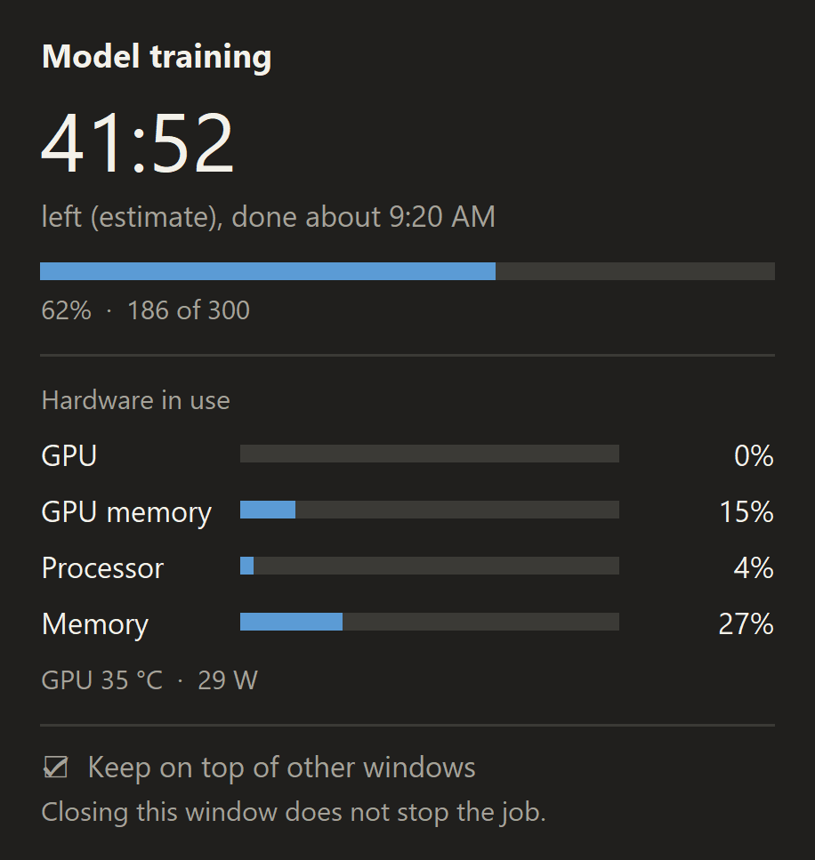
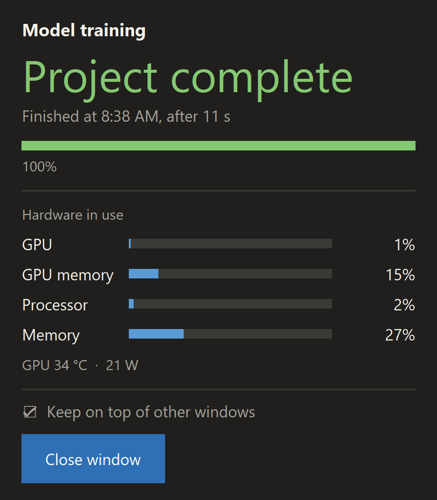

# Job monitor

A small desktop window that shows you a long job is still alive: a countdown to the
estimated finish, a progress bar, and how hard your GPU, processor and memory are working.
When the job ends it says **Project complete** and gives you a button to close it.

It is a plugin for [Claude Code](https://claude.com/claude-code): once installed, Claude
opens the window by itself whenever it starts something in the background that could take
more than 10 minutes. It also works on its own from any terminal.

| While the job runs | When it ends |
| --- | --- |
|  |  |

## What the window does

- **Countdown.** Starts from an estimate. If the job prints progress such as `[25/300]`,
  the countdown follows the job's real pace instead.
- **Hardware in use.** Live percentages for GPU, GPU memory, processor and memory, plus
  GPU temperature and power draw.
- **A clear ending.** "Project complete" when the job ends normally, "Job stopped early"
  with the exit code when it does not.
- **Stays out of the way.** It can be dragged anywhere, stays on top of other windows
  (one click turns that off), and closing it never stops the job.
- **No noise for short jobs.** The window only opens once a job has run for 10 minutes,
  or straight away when the estimate is longer than that.

Everything runs on your own computer. Nothing is sent anywhere.

## Install as a Claude Code plugin

At the prompt of a terminal session:

```
/plugin install job-monitor --marketplace Hverdu86/job-monitor
```

From a shell:

```
claude plugin install job-monitor --marketplace Hverdu86/job-monitor
```

In the desktop app, where `/plugin` does not run: click + next to the prompt box, then
Plugins, Add marketplace with `Hverdu86/job-monitor`, then Add plugin.

Answer `y` to add the marketplace, then pick a scope (the user scope makes it available in
every project).

After that there is nothing to remember. Ask Claude to run something long, or say
"show me a countdown for this", and the window appears.

## Use it without Claude

You only need the one file, `skills/job-monitor/scripts/job_monitor.py`.

See what it looks like, with a one-minute pretend job:

```
python job_monitor.py --demo
```

Start a job and watch it. Everything after `--` is your command:

```
python job_monitor.py --title "Model training" --minutes 90 --log train.log -- python train.py
```

Watch a job that is already running, by its process id:

```
python job_monitor.py --title "Video export" --minutes 45 --pid 12345
```

| Option | What it does |
| --- | --- |
| `--title` | The name shown at the top of the window |
| `--minutes` | Your estimate for the whole job. Leave it out and the window counts up |
| `--log` | File for the job's output. Progress lines in it give a live estimate |
| `--pattern` | How progress looks in the log if it is not `[done/total]`, as a regular expression with two groups |
| `--show-now` | Open the window immediately |
| `--show-after` | Seconds a job must run before the window opens (default 600) |
| `--theme` | `dark`, `light` or `auto` |
| `--cwd` | Folder to run the command in |

## Requirements

- Python 3.8 or newer with Tk. The python.org installers include Tk; on Linux install
  the `python3-tk` package.
- No other packages.
- GPU readings need an NVIDIA card (they come from `nvidia-smi`). Without one the GPU
  rows show "n/a" and the rest works.

## Status

Tested on Windows 11 with Python 3.12. The macOS and Linux code is written but has not
been tested yet; reports and fixes are welcome. On macOS, processor and memory readings
need the optional `psutil` package.

## License

MIT. Free to use, change and share.
